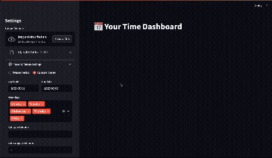

# Time Analyzer Dashboard

*A Streamlit web application to analyze and visualize your personal time management data from a Google Calendar export (.ics file).*

<!-- It's highly recommended to add a screenshot of your app here -->

<div align="center">
  
</div>


## Features

* **ICS Parser**: Ingests `.ics` calendar files, correctly handling both single and recurring events.
* **Customizable Rules**: Configure parsing rules, category delimiters, weekday/weekend definitions, and "focus session" criteria directly in the UI.
* **Interactive Dashboard**: A clean, modern UI to explore and analyze your calendar data.
* **Insightful Visualizations**:

  * **Time per Category**: Stacked bar chart of time spent on categories/subcategories.
  * **Weekday vs. Weekend**: Comparison of time allocation.
  * **Hierarchical Sunburst**: Visual breakdown of categories.
  * **"Average Day" Summary**: Pie chart of your average day distribution.
  * **Activity Heatmap**: Displays busiest/freest hours by category and weekday.

## How It Works

The project is split into two main components:

* **`runner.py`**: A CLI utility that:

  * Parses `.ics` files and expands recurring events.
  * Applies user-defined rules to tag and categorize events.
  * Enriches data.
  * Outputs a clean `calendar.csv` file.

* **`app.py`**: A Streamlit frontend that:

  * Lets users upload `.ics` files and configure settings.
  * Executes `runner.py` as a subprocess.
  * Loads `calendar.csv` and renders interactive visualizations.

## Category System
* By default, this tool uses a colon and dash-delimited system to extract categories and subcategories from your event titles. For example:
```text
Work: Deep Focus - Coding
Personal: Health - Gym
Study: Math - Linear Algebra
```

### Fully Customizable
* You don’t need to follow this default structure. In the app’s sidebar, you can:
  * Change the category delimiter (default is :)
  * Change the subcategory delimiter (default is -)
  * Ignore or flatten categories if you prefer a simpler setup
* This flexibility lets you adapt the parser to your personal naming conventions—whether simple (Work) or detailed (Work | Project A | Sprint Review).

##  Setup and Installation

### Prerequisites

* Python 3.10+
* A Google Calendar export file (`.ics`)

### 1. Clone the repository

```bash
git clone https://github.com/n9ety/time_management_panel.git
cd time_management_panel
```

### 2. Create and activate a virtual environment

**macOS/Linux:**

```bash
python3 -m venv venv
source venv/bin/activate
```

**Windows:**

```bash
python -m venv venv
.\venv\Scripts\activate
```

### 3. Install dependencies

install dependencies:

```bash
pip install -r requirements.txt
```

### 4. Configure

Settings live in `config.yaml` (gitignored, so your personal settings stay private). Start from the example:

```bash
cp config.example.yaml config.yaml
```

Set your `timezone`, the day your week starts (`week_start`, default Saturday), your `days_off`, and your
categories. Without a `config.yaml`, the example is used.

Event titles follow `CATEGORY: task #tag +project [score]`, e.g. `LEARN: calculus ch.4 #deep +exam-prep [4]`.
A spaced hyphen splits a block's time evenly, back to back: `ME: chill - youtube` from 09:00 to 11:00 counts as
`chill` 09:00-10:00 and `youtube` 10:00-11:00.

##  Usage

1. **Export your calendar**:

   * Go to [Google Calendar Settings](https://calendar.google.com/).
   * Select your calendar → Settings → Export.
   * This will download a `.zip` file containing the `.ics`.

2. **Place the file**:

   * Unzip the `.zip` and place the `.ics` file in the `data/ics/` directory.

3. **Run the app**:

```bash
streamlit run src/app.py
```

4. **Analyze**:

   * The app will open in your browser.
   * Use the sidebar to configure parsing options.
   * Click **Analyze My Time** to generate insights.

The Streamlit app is being replaced by a React frontend over a local API (in progress).

### Backend API

```bash
uvicorn api.main:app --app-dir backend --host 127.0.0.1 --port 8000
```

Interactive docs at <http://127.0.0.1:8000/api/docs>. Send the `.ics` file as the request body:

```bash
curl -X POST "http://127.0.0.1:8000/api/analyze?period=this_week" \
     -H "Content-Type: text/calendar" --data-binary @my_calendar.ics
```

Periods: `1w 2w 1m 3m 6m 1y 2y 5y` (last N days), `this_week last_week this_month last_month this_year`
(weeks follow your `week_start`), or `start=YYYY-MM-DD&end=YYYY-MM-DD`. The file stays in memory and is never
saved. `GET`/`PUT /api/config` read and save your settings (`PUT` rewrites `config.yaml`).

### Command line

```bash
python backend/runner.py --ics_path my_calendar.ics --period this_month --out my_calendar.csv
```

---

## Privacy

Your calendar is personal data. `data/`, `*.ics` files (except the synthetic test fixture in
`tests/fixtures/`), generated CSVs and secrets are listed in `.gitignore` and must never be committed.
Everything runs locally; nothing is uploaded anywhere. The API only listens on `127.0.0.1` and only accepts
requests from the local frontend (`TIME_ANALYZER_ORIGINS` changes the allowed origins).

## Development

```bash
pip install -r requirements.txt   # includes pytest
pytest
```

Tests use only the synthetic calendar in `tests/fixtures/` (see `tests/fixtures/README.md`).

## Folder Structure

```
.
├── data/                  # personal data, gitignored
│   ├── ics/               # input calendar
│   └── output/            # generated calendar.csv
├── backend/
│   ├── api/               # FastAPI app (routes, cache, JSON conversion)
│   ├── config.py          # loads, validates and saves config.yaml
│   ├── ingest.py          # calendar parsing core
│   ├── periods.py         # date-range presets
│   ├── syntax.py          # event title grammar
│   └── runner.py          # command-line tool
├── src/
│   └── app.py             # old Streamlit frontend, to be replaced
├── tests/
│   ├── fixtures/          # synthetic calendar + expected results
│   └── test_*.py
├── config.example.yaml    # settings template (copy to config.yaml)
├── pyproject.toml         # pytest settings
├── requirements.txt       # pinned runtime + test dependencies
└── README.md
```

---

