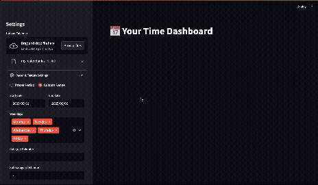

# Time Analyzer Dashboard

*A personal dashboard that shows where your time goes, from a Google Calendar you log your day in (.ics export).*

<div align="center">
  
</div>

## Features

* **Correct calendar reading**: recurring events, moved and cancelled occurrences, timezones, daylight saving and
  midnight are all handled; all-day reminders are not counted as time.
* **A title grammar for your log**: `CATEGORY: task #tag +project [score]`, e.g. `LEARN: calculus ch.4 #deep +exam-prep [4]`.
* **Overview**: where your time went (with unlogged time shown) and what grew or shrank against the period before,
  what each category was made of, how the mix changed week by week, and which projects took your time.
* **Rhythm**: your average day and whether days off differ, when in the day each activity happens, which weekdays
  carry which activity, a sleep actogram with median bedtime and wake, and a life barcode of every day in the period.
* **Data quality**: which days are fully logged, which titles need fixing, what was skipped and what overlaps.
* **Settings in the app**: timezone, the day your week starts, your days off, categories (order, color, focus).
* **Private by design**: everything runs on your computer; the calendar file is never saved.

## How it works

* **`backend/`** (Python, FastAPI): reads the `.ics`, parses titles, splits time at midnight and serves the results
  on `127.0.0.1`. Also a command-line tool (`backend/runner.py`) that exports a CSV.
* **`frontend/`** (React, Vite, TypeScript, ECharts): the dashboard in your browser.

## Setup

### Prerequisites

* Python 3.10+ and Node.js 20+
* A Google Calendar export (`.ics`): Google Calendar → Settings → Import & export → Export, then unzip.

### 1. Clone the repository

```bash
git clone https://github.com/n9ety/time_management_panel.git
cd time_management_panel
```

### 2. Install

```bash
python3 -m venv venv && source venv/bin/activate   # Windows: python -m venv venv; .\venv\Scripts\activate
pip install -r requirements.txt
cd frontend && npm install && cd ..
```

### 3. Configure

Settings live in `config.yaml` (gitignored, so your personal settings stay private). Start from the example, or
just save your settings once in the app:

```bash
cp config.example.yaml config.yaml
```

Set your `timezone`, the day your week starts (`week_start`, default Saturday), your `days_off`, and your
categories. Without a `config.yaml`, the example is used.

A spaced hyphen splits a block's time evenly, back to back: `ME: chill - youtube` from 09:00 to 11:00 counts as
`chill` 09:00-10:00 and `youtube` 10:00-11:00. Full grammar: tags `#deep`, projects `+exam-prep`, score `[1-5]`,
and the event description as a comment.

## Usage

Start the backend and the frontend in two terminals:

```bash
uvicorn api.main:app --app-dir backend --host 127.0.0.1 --port 8000
```

```bash
cd frontend && npm run dev
```

Open <http://127.0.0.1:5173> and choose your `.ics` file. It is saved on your computer only, in
`~/.time-analyzer/` (`TIME_ANALYZER_HOME` moves the folder), so the next time you open the page the dashboard is
already there. The top bar shows the file and when it was exported; from there you can replace it (or drop a new
`.ics` anywhere on the page), restore the previous one, or remove it. Days after the export are shown as "not in
this file", never as unlogged time.

### Backend API

Interactive docs at <http://127.0.0.1:8000/api/docs>. Send the `.ics` file as the request body:

```bash
curl -X POST "http://127.0.0.1:8000/api/analyze?period=this_week" \
     -H "Content-Type: text/calendar" --data-binary @my_calendar.ics
```

Each page has its own address, so you can bookmark one: `/overview`, `/rhythm`, `/data-quality`, `/settings`, all
with `?period=`.

Periods: `1w 2w 1m 3m 6m 1y 2y 5y` (last N days), `this_week last_week this_month last_month this_year`
(weeks follow your `week_start`), or `start=YYYY-MM-DD&end=YYYY-MM-DD`. Sent without a body, `/api/analyze` uses the
saved calendar.

`GET`/`PUT /api/config` read and save your settings (`PUT` rewrites `config.yaml`). The saved calendar is
`GET /api/calendar` (its facts), `PUT /api/calendar?name=&data_as_of=` (raw body; parsed before it is saved),
`POST /api/calendar/check` (compares a file with the saved one without saving it),
`POST /api/calendar/restore` and `DELETE /api/calendar`.

### Command line

```bash
python backend/runner.py --ics_path my_calendar.ics --period this_month --out my_calendar.csv
```

---

## Privacy

Your calendar is personal data. `data/`, `*.ics` files (except the synthetic test fixture in
`tests/fixtures/`), generated CSVs, `config.yaml` and secrets are listed in `.gitignore` and must never be committed.
Everything runs locally; nothing is uploaded anywhere. The API only listens on `127.0.0.1` and only accepts
requests from the local frontend (`TIME_ANALYZER_ORIGINS` changes the allowed origins). The calendar you load is
kept in `~/.time-analyzer/` — outside the repository, so it can never be committed — together with one previous
copy for Undo. "Remove from this computer" deletes both. Nothing is uploaded anywhere.

## Development

```bash
pytest                            # backend (includes the API tests)
cd frontend && npm test           # frontend (Vitest)
cd frontend && npm run typecheck
```

Tests use only the synthetic calendar in `tests/fixtures/` (see `tests/fixtures/README.md`).

## Folder Structure

```
.
├── backend/
│   ├── api/               # FastAPI app (routes, cache, JSON conversion)
│   ├── config.py          # loads, validates and saves config.yaml
│   ├── ingest.py          # calendar parsing core
│   ├── periods.py         # date-range presets
│   ├── store.py           # the calendar remembered in ~/.time-analyzer/
│   ├── syntax.py          # event title grammar
│   └── runner.py          # command-line tool
├── frontend/
│   └── src/
│       ├── lib/           # API client, calculations behind each chart, takeaway lines, routes, formats
│       ├── charts/        # ECharts options
│       ├── components/    # shared UI pieces
│       └── pages/         # Welcome, Overview, Rhythm, Data quality, Settings
├── tests/
│   ├── fixtures/          # synthetic calendar + expected results
│   └── test_*.py
├── config.example.yaml    # settings template (copy to config.yaml)
├── pyproject.toml         # pytest settings
├── requirements.txt       # pinned Python dependencies
└── README.md
```

---
